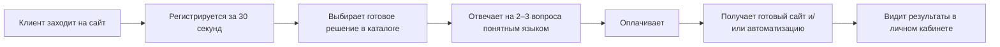
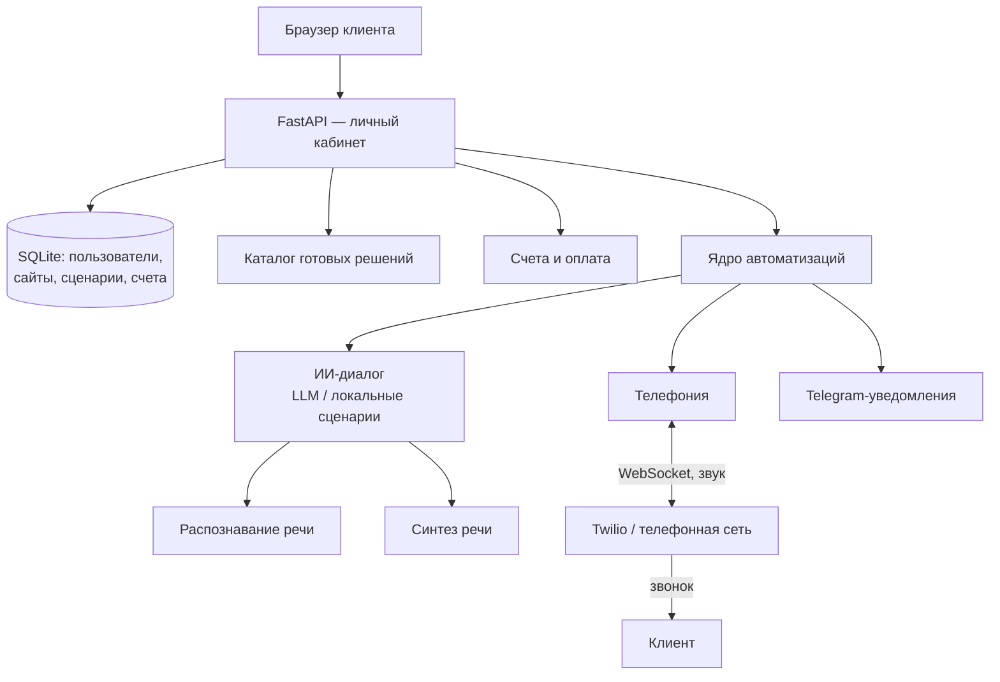
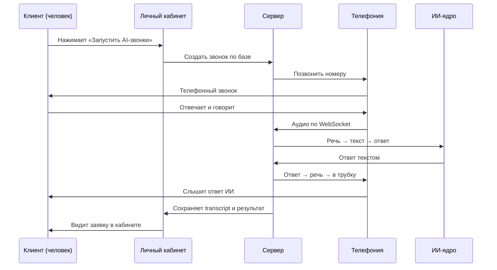

# Как работает ClirntCabinet — простая схема

## 1. Путь клиента (самое главное)

Никаких промптов, API, нод и программистов. Клиент видит только понятные кнопки и вопросы.

## 2. Из чего состоит приложение

## 3. Как именно ИИ звонит

Если ключей/номера ещё нет, работает **демо-режим**: звонок имитируется, а поговорить с ИИ можно прямо в браузере через микрофон.

## 4. Что уже готово (23 ноября)

- Личный кабинет: регистрация, вход, дашборд, каталог из 5 решений.
- Создание сайта через короткую анкету.
- Счета и демо-оплата.
- Ядро ИИ-диалога на русском: сценарии продаж, поддержки, напоминаний.
- Подготовлены STT/TTS и обработка телефонного аудио (mu-law).

## 5. Что доделываем до 30 ноября

| Дата | Задача |
|------|--------|
| 24 ноября | Рабочий call-центр: адаптер звонков + веб-разговор + журнал звонков в кабинете |
| 25 ноября | Публикация сайтов по отдельному адресу |
| 26 ноября | Telegram-уведомления о заявках |
| 27 ноября | Оплата: реальная или полированный демо-режим |
| 28 ноября | Связка «решение из каталога → реально работает» |
| 29 ноября | Тесты, исправления, деплой на сервер |
| 30 ноября | Финальная проверка и сдача |

## 6. Что нужно от вас для реальных звонков

1. Аккаунт телефонного провайдера (Twilio) и номер с разрешёнными исходящими звонками.
2. `OPENAI_API_KEY` — чтобы ИИ понимал и говорил голосом.
3. Публичный адрес сервера (домен или ngrok) для WebSocket-аудио.
4. Данные для приёма платежей — если хотим реальные деньги, а не демо.

Без пунктов 1–4 продукт всё равно будет готов, но в демо-режиме: разговор в браузере + имитация звонков.
