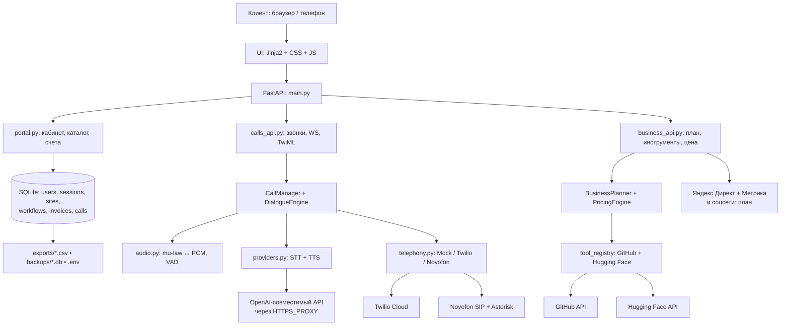

# Инфраструктура — коротко и полно

## Схема (18 блоков)

## Слои и файлы

| Слой | Файлы | Что делает |
|------|-------|------------|
| UI | `app/templates/`, `app/static/` | Страницы кабинета, голосовой виджет |
| API | `main.py`, `portal.py`, `calls_api.py`, `business_api.py` | HTTP, WebSocket, вебхуки |
| Домен | `dialogue.py`, `telephony.py`, `planner.py`, `pricing.py` | Диалог, звонки, план, цена |
| Инфраструктура | `db.py`, `providers.py`, `audio.py`, `tool_registry.py` | БД, речь, звук, поиск инструментов |
| Внешние | OpenAI, Twilio, Novofon, GitHub, HF, Яндекс | Голос, звонки, инструменты, реклама |
| Развёртывание | `uvicorn`, Nginx, Docker, ngrok | Публичный HTTPS/WSS адрес |

## Данные

Одна таблица на сущность, всё с `user_id`: `users`, `sessions`, `sites`, `workflows`, `invoices`, `calls`. Файл — `data/app.db` (SQLite, WAL). Секреты — только в `.env`, не в git.

## Ключевые переменные

| Переменная | Зачем |
|------------|-------|
| `AI_CALL_MODE` | `demo` или `openai` |
| `OPENAI_API_KEY`, `OPENAI_BASE_URL` | Мозг, STT, TTS |
| `HTTPS_PROXY` | Иностранный сервер для обхода ограничения региона |
| `CALL_PROVIDER` | `mock` / `twilio` / `novofon` |
| `GITHUB_TOKEN`, `HF_TOKEN` | Поиск инструментов |
| `HOURLY_RATE` | Расчёт цены |

## Ветви

`main` — база; `feature/call-center`, `feature/novofon`, `feature/agent-hub`, `feature/yandex-ads`, `feature/metricool`, `feature/pricing`, `feature/utilities`.

## Два главных потока

1. **Звонок:** кнопка → REST → провайдер → WebSocket-аудио → STT → ИИ → TTS → трубка → запись в `calls`.
2. **Один промпт:** промпт → `BusinessPlanner` → поиск GitHub/HF → план из 9 шагов → цена и окупаемость → подтверждение → Site/Metrica/Direct/Соцсети/Деплой.

## Безопасность

Пароли PBKDF2, сессии — токены в HttpOnly-cookie, чужой код из GitHub не исполняется, деньги и публикации только после подтверждения.
